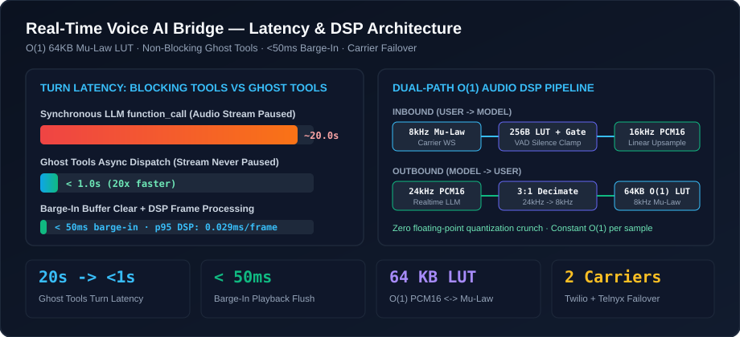
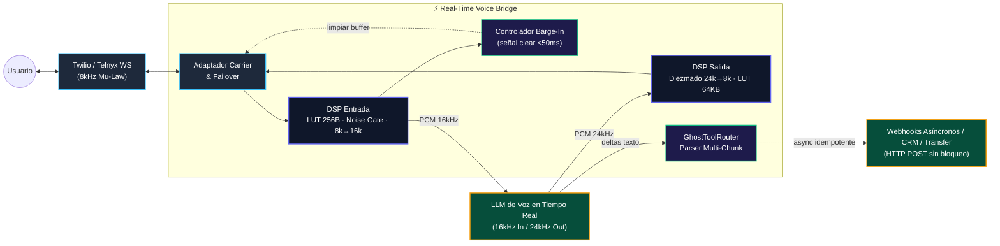
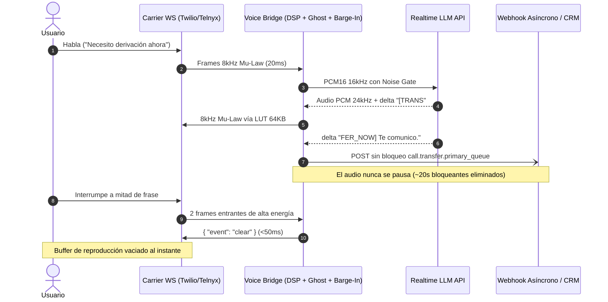

# Real-Time Voice AI Bridge & Ghost Tools Pattern

[](https://github.com/SerjCallier/realtime-voice-ai-bridge/actions)


[English](README.md) | **Español**

Prueba de concepto arquitectónica sanitizada para un **bridge de voz IA en tiempo real sub-segundo**: **DSP O(1) con tabla LUT Mu-Law de 64KB**, **interrupción barge-in &lt;50ms**, **despacho asíncrono Ghost Tools sin bloqueo** y **failover entre carriers** (Twilio ↔ Telnyx). Corre 100% offline sin credenciales ni dependencias externas en runtime.

> Implementación de referencia extraída de arquitectura productiva de recepción por voz, generalizada y limpia de prompts propietarios, teléfonos o secretos.

---



---

## Por qué existe esta arquitectura

La telefonía productiva transmite **G.711 Mu-Law a 8kHz** por WebSockets, mientras que los modelos de voz multimodales esperan **PCM16 a 16kHz** de entrada y emiten **PCM16 a 24kHz** de salida. Dos cuellos de botella arruinan la experiencia en llamada:

1. **Round-trips bloqueantes de `function_call` (~20s de lag):** Pausar el stream de audio mientras el LLM arma esquemas JSON y espera webhooks síncronos genera silencios incómodos.
2. **Transcodificación por muestra y colisiones de voz:** Convertir audio muestra a muestra genera ruido metálico ("crunching"), y sin detección de colisión el agente sigue hablando encima del usuario.

Este bridge resuelve ambos problemas con cuatro primitivas deterministas:

- **LUT Mu-Law de 64KB O(1) + Resampling:** Tabla precomputada de 64KB (`Int16` → `Uint8` Mu-Law) y tabla de decodificación de 256 entradas, junto con un Noise Gate para silenciar ruido de línea antes del VAD del modelo.
- **Despacho Asíncrono Ghost Tools (`20s → <1s`):** En lugar de tool calls síncronas bloqueantes, el modelo emite tokens de control livianos en línea (ej. `[TRANSFER_NOW]`). El bridge los intercepta incluso partidos entre chunks, los limpia del texto y dispara webhooks idempotentes sin frenar el audio.
- **Barge-In Sub-50ms:** Frames consecutivos de voz entrante mientras el asistente está hablando disparan un evento `clear` inmediato al carrier (`streamSid` / `stream_id`) para vaciar el buffer de reproducción.
- **Failover Agnóstico de Carrier:** Normaliza Twilio Media Streams y Telnyx TeXML detrás de un único contrato y conmuta automáticamente ante bloqueos regulatorios o errores `403`/`429`/`5xx`.

---

## Flujo de Arquitectura del Sistema



---

## Secuencia: Ghost Tools + Barge-In Sub-50ms



---

## Stack Tecnológico

| Capa | Tecnología | Rol en la Arquitectura |
| :--- | :--- | :--- |
| **Runtime** | Node.js 20+ (ESM, cero deps) | Event loop no bloqueante para streams WebSocket concurrentes |
| **DSP & Codec** | Tabla LUT 64KB + `Int16Array` | Transcodificación `O(1)` G.711 Mu-Law ↔ PCM16 y resampling |
| **Plano de Control** | `GhostToolRouter` | Detección de tags entre chunks y webhooks asíncronos idempotentes |
| **Interrupción** | `BargeInController` | Colisión por energía de voz consecutiva → señal `clear` inmediata |
| **Telefonía** | `CarrierFailoverAdapter` | Normalización Twilio Media Streams / Telnyx TeXML + failover |
| **Verificación** | `node --test` + GitHub Actions | Suite determinista offline y benchmark de 1.000 frames |

---

## Estructura Mínima de Configuración

Las credenciales viven en `.env` (ver `.env.example`); los parámetros operativos en `config.example.json`:

```json
{
  "dsp": {
    "carrierSampleRateHz": 8000,
    "modelInputSampleRateHz": 16000,
    "modelOutputSampleRateHz": 24000,
    "noiseGateAmplitude": 100,
    "use64KbMulawLut": true
  },
  "bargeIn": {
    "enabled": true,
    "speechEnergyThreshold": 350,
    "consecutiveSpeechFrames": 2,
    "maxReactionBudgetMs": 50
  },
  "ghostTools": {
    "enabled": true,
    "stripTagsFromTranscript": true,
    "routes": {
      "[TRANSFER_NOW]": "call.transfer.primary_queue",
      "[ESCALATE_HITL]": "alert.hitl.urgent"
    }
  },
  "carriers": {
    "primary": "twilio",
    "fallback": "telnyx",
    "failoverOnStatusCodes": [400, 403, 429, 500, 502, 503]
  }
}
```

---

## Inicio Rápido y Verificación Offline

Requiere **Node.js 20+**. No necesita claves API ni `npm install`.

```bash
git clone https://github.com/SerjCallier/realtime-voice-ai-bridge.git
cd realtime-voice-ai-bridge

# Correr suite determinista de unit tests e integración HTTP/WebSocket
npm test

# Correr benchmark de 1.000 frames y simulación end-to-end
npm run demo

# Levantar servidor HTTP/WebSocket nativo (/health, /v1/dsp/inbound, /ws/media-stream)
npm start
```

---

## Licencia

MIT © [Sergio Callier](https://github.com/SerjCallier)
