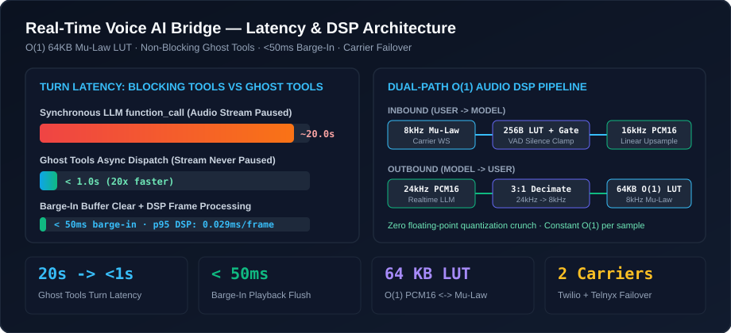
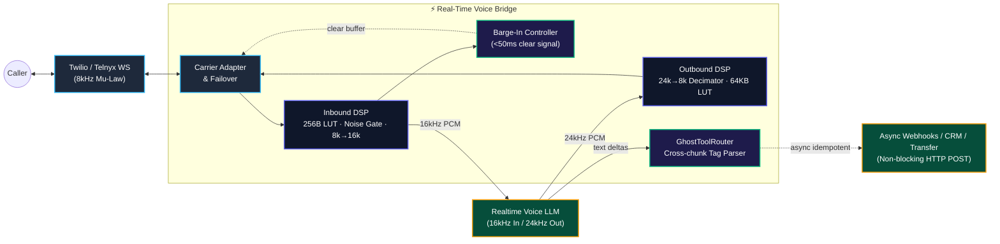
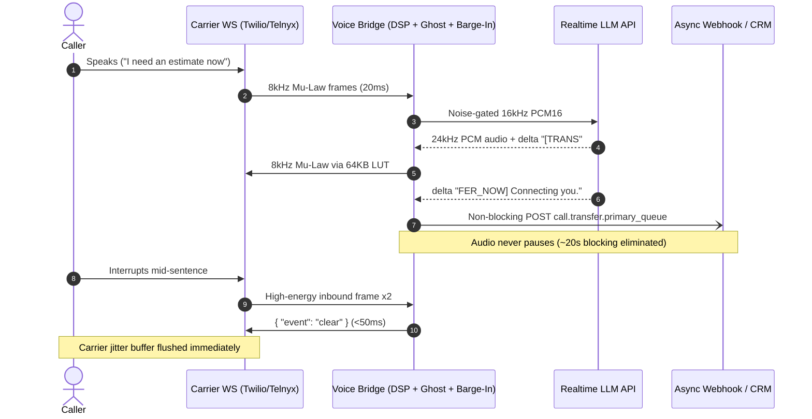

# Real-Time Voice AI Bridge & Ghost Tools Pattern

[](https://github.com/SerjCallier/realtime-voice-ai-bridge/actions)


**English** | [Español](README.es.md)

Sanitized architectural proof of concept for a **sub-second real-time voice AI bridge**: **O(1) 64KB Mu-Law LUT audio DSP**, **&lt;50ms barge-in interruption**, **non-blocking Ghost Tools async dispatch**, and **carrier failover** (Twilio ↔ Telnyx). Runs 100% offline with zero credentials or external runtime dependencies.

> Reference implementation extracted from production voice-receptionist architecture, generalized and stripped of any client-specific prompts, phone numbers, or secrets.

---



---

## Why This Architecture Exists

Production telephony runs on **8kHz G.711 Mu-Law** over WebSockets, while modern multimodal realtime LLMs expect **16kHz PCM16** inbound and emit **24kHz PCM16** outbound. Two naive bottlenecks destroy call quality:

1. **Blocking LLM `function_call` round-trips (~20s lag):** Pausing an active audio WebSocket while waiting for tool schemas, JSON round-trips, and webhook execution produces unnatural dead air.
2. **Per-sample floating-point transcoding & jitter buffers:** Naive sample conversion introduces metallic quantization noise ("crunching"), while missing collision detection lets the AI keep talking over an interrupting caller.

This bridge solves both with four deterministic primitives:

- **O(1) 64KB Mu-Law LUT + Resampling:** Precomputed 64KB encode lookup table (`Int16` → `Uint8` Mu-Law) and 256-entry decode table, paired with a Noise Gate to clamp line hum to pure silence before model VAD.
- **Ghost Tools Async Dispatch (`20s → <1s`):** Instead of synchronous blocking tool calls, the model emits lightweight inline control tokens (e.g., `[TRANSFER_NOW]`). The bridge intercepts them across chunk boundaries, strips them from clean text, and fires idempotent async webhooks without pausing audio.
- **Sub-50ms Barge-In:** Consecutive inbound speech frames colliding with active AI playback trigger an immediate carrier `clear` event (`streamSid` / `stream_id`) to flush remote playback buffers.
- **Carrier-Agnostic Failover:** Normalizes Twilio Media Streams and Telnyx TeXML streams behind one envelope, automatically switching carriers on regulatory or outbound `403`/`429`/`5xx` blocks.

---

## System Architecture Flow



---

## Sequence: Ghost Tools + Sub-50ms Barge-In



---

## Tech Stack

| Layer | Technology | Role in Architecture |
| :--- | :--- | :--- |
| **Runtime** | Node.js 20+ (ESM, zero runtime deps) | Non-blocking event loop for concurrent WebSocket streams |
| **DSP & Codec** | Precomputed 64KB LUT + `Int16Array` | `O(1)` G.711 Mu-Law ↔ PCM16 transcoding & linear resampling |
| **Control Plane** | `GhostToolRouter` | Cross-chunk semantic tag parsing & idempotent async webhooks |
| **Interruption** | `BargeInController` | Consecutive-frame speech energy collision → instant `clear` |
| **Telephony** | `CarrierFailoverAdapter` | Twilio Media Streams & Telnyx TeXML normalization + failover |
| **Verification** | `node --test` + GitHub Actions | Offline deterministic unit tests & 1,000-frame benchmark |

---

## Minimal Configuration Structure

Sensitive values stay in `.env` (see `.env.example`); behavioral tuning lives in `config.example.json`:

```json
{
  "dsp": {
    "carrierSampleRateHz": 8000,
    "modelInputSampleRateHz": 16000,
    "modelOutputSampleRateHz": 24000,
    "noiseGateAmplitude": 100,
    "use64KbMulawLut": true
  },
  "bargeIn": {
    "enabled": true,
    "speechEnergyThreshold": 350,
    "consecutiveSpeechFrames": 2,
    "maxReactionBudgetMs": 50
  },
  "ghostTools": {
    "enabled": true,
    "stripTagsFromTranscript": true,
    "routes": {
      "[TRANSFER_NOW]": "call.transfer.primary_queue",
      "[ESCALATE_HITL]": "alert.hitl.urgent"
    }
  },
  "carriers": {
    "primary": "twilio",
    "fallback": "telnyx",
    "failoverOnStatusCodes": [400, 403, 429, 500, 502, 503]
  }
}
```

---

## Quickstart & Offline Verification

Requires **Node.js 20+**. No API keys or `npm install` needed.

```bash
git clone https://github.com/SerjCallier/realtime-voice-ai-bridge.git
cd realtime-voice-ai-bridge

# Run deterministic unit test suite (DSP LUT, noise gate, Ghost Tools, barge-in, failover)
npm test

# Run 1,000-frame DSP latency & event simulation benchmark
npm run demo
```

Observed benchmark output (`node src/demo.js`):

```json
{
  "dsp_frames_benchmarked": 1000,
  "dsp_roundtrip_p50_ms": 0.0047,
  "dsp_roundtrip_p95_ms": 0.0291,
  "ghost_tools_dispatched": ["call.transfer.primary_queue"],
  "barge_in_interrupted": true,
  "carrier_failover": { "carrierUsed": "telnyx", "failoverTriggered": true, "primaryErrorCode": 403 }
}
```

---

## Project Structure

```text
realtime-voice-ai-bridge/
├── .github/workflows/ci.yml      # GitHub Actions (Node 20 & 22)
├── docs/architecture-latency.svg # Latency & DSP visual chart
├── src/
│   ├── dsp.js                    # 64KB Mu-Law LUT, noise gate, 8k↔16k/24k resampling
│   ├── ghost-tools.js            # Cross-chunk tag parser & idempotent async dispatcher
│   ├── barge-in.js               # <50ms audio collision & buffer clear controller
│   ├── carrier-adapter.js        # Twilio / Telnyx frame normalizer + failover
│   ├── index.js                  # Public module exports
│   └── demo.js                   # Offline 1,000-frame benchmark & flow demo
├── tests/voice-bridge.test.js    # 7 offline unit tests (node --test)
├── config.example.json           # Minimal non-sensitive configuration schema
├── .env.example                  # Placeholder environment variables
├── README.md                     # English documentation
└── README.es.md                  # Spanish documentation
```

---

## License

MIT © [Sergio Callier](https://github.com/SerjCallier)
